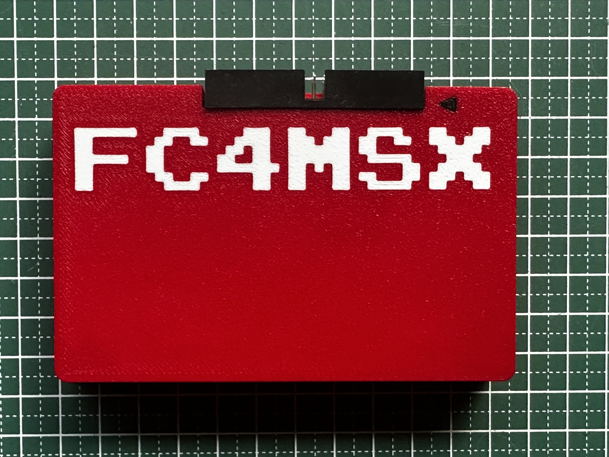
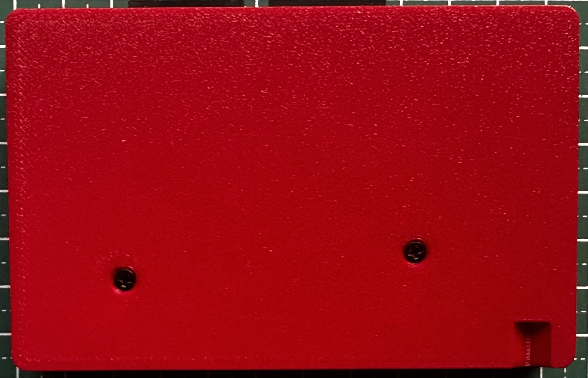
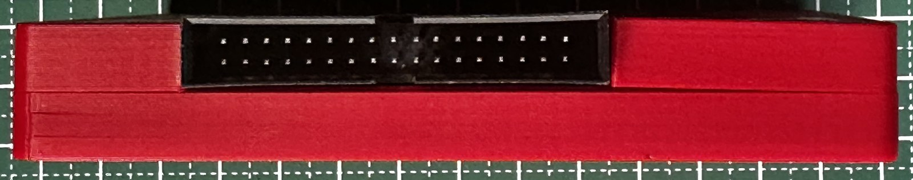

# FC4MSX 3D Enclosure

This folder contains the 3D-printable cartridge enclosure files for the FC4MSX floppy controller.

## Photos

| Front | Back | Top Cutout |
| :---: | :---: | :---: |
|  |  |  |

## File Inventory
- [**`FC4MSX-bottom.stl`**](FC4MSX-bottom.stl): Lower shell half with mounting standoffs and cartridge guide rails.
- [**`FC4MSX-top.stl`**](FC4MSX-top.stl): Upper shell half with opening for the 34-pin floppy connector.
- [**`FC4MSX.3mf`**](FC4MSX.3mf): Multi-body project file with optimal print orientation, perimeters, and slicer settings (Bambu Studio / PrusaSlicer / OrcaSlicer).

## Recommended Slicer Settings
| Parameter | Setting | Rationale |
| :--- | :--- | :--- |
| **Material** | PLA+, PETG, or ABS/ASA | PETG/ABS offer great snap-fit and impact resistance |
| **Layer Height** | 0.16 mm - 0.20 mm | Smooth outer bevels and precise slot tolerances |
| **Walls / Perimeters** | 3 - 4 walls | Ensures solid screw posts and sturdy connector cutouts |
| **Top / Bottom Layers** | 4 - 5 layers | Rigid outer faces |
| **Infill** | 20% - 25% (Gyroid or Grid) | Good strength-to-weight balance |
| **Supports** | None / Optional | Place outer flat faces directly onto the build plate |

## Assembly Instructions
1. Test-fit the bare PCB inside the bottom shell half ([`FC4MSX-bottom.stl`](FC4MSX-bottom.stl)) to verify clearance around the MSX 50-pin edge connector.
2. Ensure the 34-pin boxed header on the PCB aligns cleanly with the cutout in the top shell half ([`FC4MSX-top.stl`](FC4MSX-top.stl)).
3. Carefully mate the top and bottom shell halves around the PCB.
4. Secure the halves using screws (do not over-tighten into the printed standoffs).
