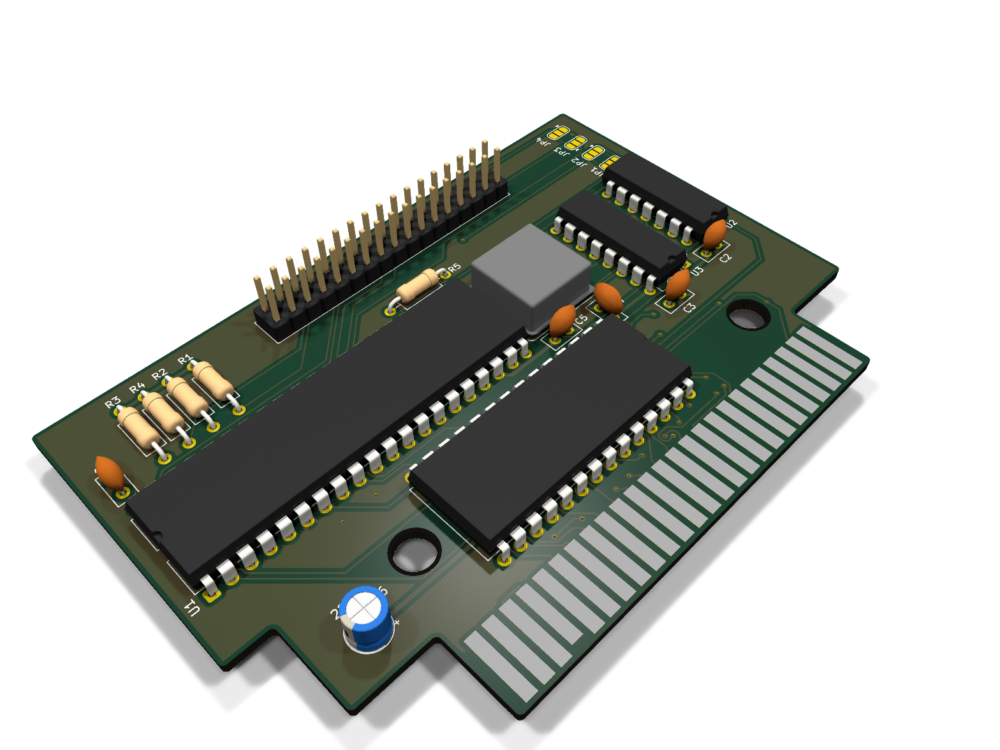
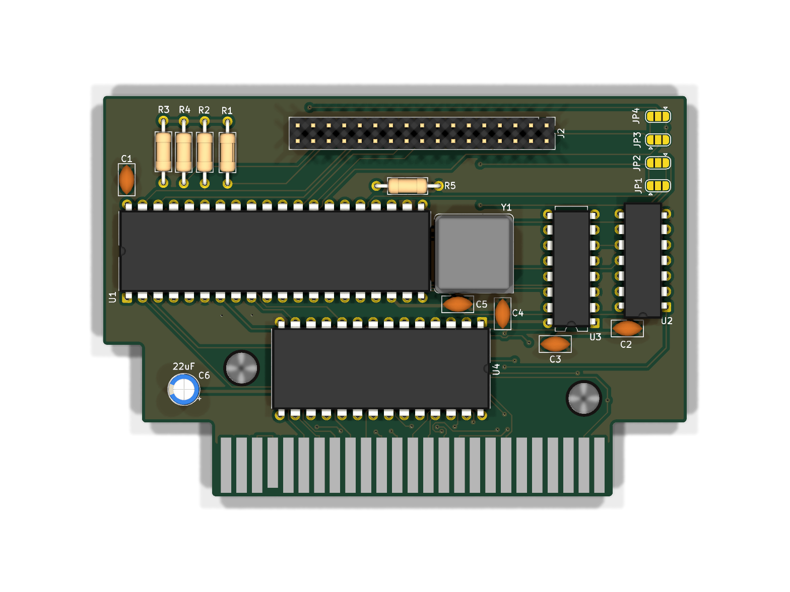
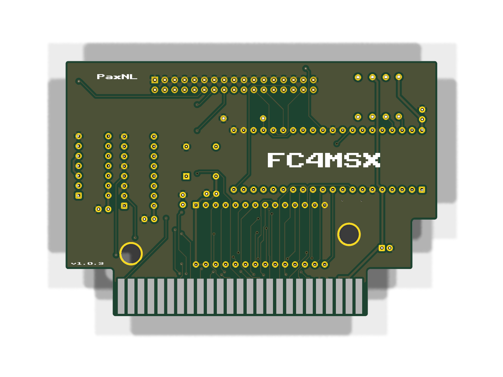

# FC4MSX

Floppy Disk Controller cartridge for MSX computers based on the Talent TDC-600 design.

## Previews

| 3D View | Top | Bottom |
| :---: | :---: | :---: |
|  |  |  |

## Features

- Standard MSX 50-pin cartridge slot form factor (compatible with MSX, MSX2, MSX2+, turboR).
- Based on the Western Digital WD37C65 floppy disk controller.
- Standard 34-pin header for connecting PC 3.5" floppy drives or Gotek emulators (FlashFloppy).
- Single 27C512 / W27C512 EEPROM for the MSX-DOS Disk ROM.
- Custom 3D printable shell included.

## PCB Fabrication

Ready-to-order Gerbers are available in the [gerbers](gerbers/) directory:
- Production package: [FC4MSX-Gerbers-v1.0.3.zip](gerbers/FC4MSX-Gerbers-v1.0.3.zip)

Recommended fabrication parameters:
- Layers: 2
- Board thickness: 1.6 mm
- Surface finish: ENIG (recommended for edge connector contact wear resistance)
- Edge connector: 45° bevel / chamfer

## Bill of Materials

An Interactive HTML BOM is provided at [bom/ibom.html](bom/ibom.html). Open it in any browser to inspect component placements on the PCB.

| Ref | Value / Part | Footprint | Notes |
| :--- | :--- | :--- | :--- |
| U1 | WD37C65 | DIP-40 (600 mil) | Floppy Disk Controller |
| U2 | 74LS04 | DIP-14 (300 mil) | Hex inverter |
| U3 | 74LS138 | DIP-16 (300 mil) | 3-to-8 decoder |
| U4 | W27C512 | DIP-28 (600 mil) | TDC-600 MSX-DOS Disk ROM |
| Y1 | 16 MHz | DIP-8 | Crystal oscillator |
| J1 | MSX Edge | Card edge | Standard MSX 50-pin slot connector |
| J2 | FDD Header | 2x17 pin header, 2.54 mm pitch | Standard 34-pin floppy interface |
| C1–C5 | 100 nF | 2.5 mm pitch | Ceramic decoupling capacitors |
| C6 | 22 µF | Radial, 2.0 mm pitch, 5 mm dia | Electrolytic capacitor (16V+) |
| R1–R4 | 150 Ω | Axial DIN0207 | Pull-up resistors |
| R5 | 1 kΩ | Axial DIN0207 | Resistor |
| JP1–JP4 | Solder jumpers | 3-pad SMD | Solder bridge configuration pads |

Using quality DIP sockets for U1, U2, U3, and U4 is recommended.

## 3D Printed Cartridge Shell

Files are located in the [3d-enclosure](3d-enclosure/) directory:
- `FC4MSX-bottom.stl`: Lower shell half.
- `FC4MSX-top.stl`: Upper shell half with opening for the 34-pin cable.
- `FC4MSX.3mf`: Slicer project file with layout and suggested print orientation.

Slicer suggestions:
- Material: PETG or PLA+ (or ABS/ASA)
- Layer height: 0.16–0.20 mm
- Perimeters: 3–4 walls for screw boss rigidity
- Infill: 20–25%

## Usage Notes

1. Connect a 34-pin ribbon cable between J2 and your drive or Gotek emulator.
   - For PC drives or Gotek with FlashFloppy, check drive select jumper settings (typically DS0 / S0 for direct connection). See [docs/PINOUT.md](docs/PINOUT.md).
2. Ensure power is supplied to the floppy drive (e.g. 5V on Gotek).
3. Insert the cartridge with the MSX powered off.
4. Boot the machine with a formatted MSX-DOS disk in the drive.

## Repository Contents

```text
fc4msx/
├── 3d-enclosure/   # Shell STL and 3MF files
├── bom/            # Component list and interactive HTML BOM
├── docs/           # Pinouts and assembly notes
├── gerbers/        # Production Gerber ZIP and drill files
├── images/         # PCB render previews
├── LICENSE
└── README.md
```

## Credits

- Architecture based on the Talent TDC-600 disk controller.
- Thanks to the MSX Resource Center community for hardware documentation and Disk ROM preservation.

## License

This project is licensed under the Creative Commons Attribution-NonCommercial-ShareAlike 4.0 International License (CC BY-NC-SA 4.0).

Commercial manufacturing, distribution, or sale of PCBs, assembled cartridges, or enclosure prints is not permitted without prior approval. For commercial licensing inquiries, contact the author.
